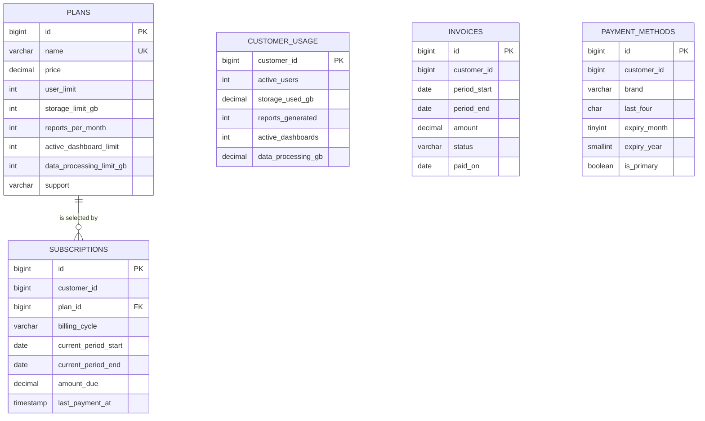

# Edabip Prathibha Billing API

A Spring Boot REST API for subscription plans and customer subscriptions. The plans module and plan/subscription persistence mapping use Spring Data JPA with MySQL. Hibernate validates the manually managed SQL schema at startup.

## Project layout

```text
src/main/java/com/edabip/billing/
|-- EdabipApplication.java
|-- controller/   HTTP endpoints
|-- service/      application logic
|-- repository/   JDBC queries and row mapping
|-- model/        request and response models
`-- exceptionHandler/ shared response format and exception handling

src/main/resources/
|-- application.properties
|-- schema.sql
`-- data.sql
```

## Task 3, Day 1

Plan persistence now uses `PlanEntity` and `PlanJpaRepository`; list paging and sorting use Spring Data `Pageable`. Existing service/controller DTOs preserve the public JSON shape. `SubscriptionEntity` maps the plan many-to-one relationship, with the inverse collection on `PlanEntity`; subscription lookups fetch the plan needed for the response. The SQL schema remains the source of truth, and `spring.jpa.hibernate.ddl-auto=validate` checks it without modifying tables.

## Requirements

- Java 17 or newer
- Maven 3.6.3 or newer
- MySQL 8.0.16 or newer

## Database setup

Create the database in MySQL:

```sql
CREATE DATABASE edabip_prathibha CHARACTER SET utf8mb4 COLLATE utf8mb4_0900_ai_ci;
```

From the repository root, apply the schema and then insert the sample plans:

```sh
mysql -u root -p edabip_prathibha < src/main/resources/schema.sql
mysql -u root -p edabip_prathibha < src/main/resources/data.sql
```

The schema creates `plans`, `subscriptions`, `customer_usage`, `invoices`, and `payment_methods`. It defines the subscription-to-plan foreign key and checks plan limits, invoice status/period, and payment expiry fields. Sample usage, invoices, and payment methods belong to customer 1. Replace example prices and limits with product-approved values before production use. The payment-method table contains only a brand, last four digits, expiry, and primary flag; it has no full card number or CVV columns.

For a database already created from Task 1, apply `src/main/resources/upgrade-day2.sql` and then `src/main/resources/upgrade-task2.sql`, once each, instead of rerunning `schema.sql`. The first adds plan activation; the second adds usage, invoice and payment-method tables and sample billing records.

## Configuration

`src/main/resources/application.properties` reads these environment variables:

| Variable | Default | Description |
| --- | --- | --- |
| `DB_URL` | `jdbc:mysql://localhost:3306/edabip_prathibha?serverTimezone=UTC` | MySQL JDBC URL |
| `DB_USERNAME` | required | MySQL username |
| `DB_PASSWORD` | required | MySQL password |
| `PORT` | `8080` | HTTP port |

PowerShell example:

```powershell
$env:DB_PASSWORD = 'your-password'
$env:DB_USERNAME = 'your-database-user'
```

SQL initialization is disabled at application startup. Apply `schema.sql` and `data.sql` manually as shown above; this avoids rerunning `CREATE TABLE` every time the API starts.

## Run

```sh
mvn spring-boot:run
```

Or build and run the executable jar:

```sh
mvn clean package
java -jar target/prathibha-api-0.1.0.jar
```

## API endpoints

| Method | Endpoint | Description |
| --- | --- | --- |
| `POST` | `/api/plans` | Creates a plan |
| `GET` | `/api/plans?page=0&size=20&sort=price,asc` | Lists plans with pagination and sorting |
| `GET` | `/api/plans/{id}` | Gets a plan by ID |
| `PUT` | `/api/plans/{id}/activate` | Activates a plan |
| `PUT` | `/api/plans/{id}/deactivate` | Deactivates a plan |
| `GET` | `/api/subscription?customerId={customerId}` | Gets the customer's current subscription |
| `POST` | `/api/subscription` | Creates a subscription |
| `GET` | `/api/subscription/{id}` | Gets a subscription by ID |
| `PUT` | `/api/subscription/{id}/plan` | Changes a subscription's plan |
| `GET` | `/api/usage?customerId={customerId}` | Returns five usage metrics against the customer's current plan limits |
| `GET` | `/api/invoices?customerId={customerId}&page=0&size=20&status=Due&sort=periodStart,desc` | Lists invoices with optional status filter and pagination |
| `GET` | `/api/invoices/summary?customerId={customerId}` | Returns total paid, invoice count and outstanding due amount |
| `GET` | `/api/invoices/monthly-totals?customerId={customerId}` | Returns totals for each of the last six calendar months, including empty months |
| `GET` | `/api/payment-methods?customerId={customerId}` | Lists saved payment method summaries |
| `POST` | `/api/payment-methods?customerId={customerId}` | Adds a method using brand, last four digits and expiry only |
| `PUT` | `/api/payment-methods/{id}/primary?customerId={customerId}` | Transactionally switches the primary payment method |
| `DELETE` | `/api/payment-methods/{id}?customerId={customerId}` | Removes a non-primary payment method |

Payment method creation accepts `brand`, `lastFour`, `expiryMonth`, `expiryYear`, and optional `makePrimary`. The first saved method is made primary automatically. A primary method cannot be removed until another method is selected. The request model has no full card number or CVV fields, and the database stores neither.

Plan and invoice pagination is zero-based with `size` from 1 to 100. Plan `sort` accepts `name`, `price`, `userLimit`, `storageLimitGb`, `reportsPerMonth`, or `active`, followed by `asc` or `desc` (for example `price,desc`). Invoice `sort` accepts `periodStart`, `periodEnd`, `amount`, `status`, or `paidOn`; invoice status accepts `Paid` or `Due`.

The current-subscription endpoint requires a `customerId` because the API does not include authentication or a customer session. It returns a subscription whose billing period includes today's date; if multiple periods match, it returns the one with the latest start date.

Create a plan:

```sh
curl -X POST http://localhost:8080/api/plans \
  -H 'Content-Type: application/json' \
  -d '{
    "name": "Business",
    "price": 49.99,
    "userLimit": 25,
    "storageLimitGb": 100,
    "reportsPerMonth": 500,
    "activeDashboardLimit": 10,
    "dataProcessingLimitGb": 100,
    "support": "Priority email"
  }'
```

List plans:

```sh
curl http://localhost:8080/api/plans
```

Get a customer's current subscription:

```sh
curl "http://localhost:8080/api/subscription?customerId=1"
```

Create a subscription:

```sh
curl -X POST http://localhost:8080/api/subscription \
  -H 'Content-Type: application/json' \
  -d '{
    "customerId": 1,
    "planId": 1,
    "billingCycle": "MONTHLY",
    "currentPeriodStart": "2026-10-01",
    "currentPeriodEnd": "2026-11-01"
  }'
```

`billingCycle` accepts `MONTHLY` or `ANNUAL`. `amountDue` is initialized to the selected plan's price for either cycle; annual pricing adjustments are not implemented.

Change a subscription's plan (the subscription period stays the same, and `amountDue` is set to the new plan's price):

```sh
curl -X PUT http://localhost:8080/api/subscription/1/plan \
  -H 'Content-Type: application/json' \
  -d '{"planId": 2}'
```

Activate or deactivate a plan:

```sh
curl -X PUT http://localhost:8080/api/plans/2/activate
curl -X PUT http://localhost:8080/api/plans/2/deactivate
```

Inactive plans remain visible in the plan list but cannot be used for new subscriptions or plan changes. Existing subscriptions to a deactivated plan continue to work.

For a new database, use the updated `schema.sql` and `data.sql` instead of either upgrade script.

## Responses and validation

Responses use a shared JSON envelope. For example:

```json
{
  "success": true,
  "data": [{ "id": 1, "name": "Basic" }],
  "error": null
}
```

Errors use `success: false` and include an error code, message, and optional details. Request fields and positive path IDs are validated; invalid requests return a `400`, and missing records return a `404`.

## Swagger and OpenAPI

- Swagger UI: [http://localhost:8080/swagger-ui.html](http://localhost:8080/swagger-ui.html)
- OpenAPI JSON: [http://localhost:8080/v3/api-docs](http://localhost:8080/v3/api-docs)

## Unit tests

Run the service-layer tests with:

```sh
mvn test
```

`BillingServiceTest`, `PlanServiceTest`, and `SubscriptionServiceTest` use JUnit 5 and Mockito. Together they cover usage calculations, invoice filters/pagination, payment-method invariants, plan paging and activation, subscription creation and plan changes, and failure cases such as not found, duplicate constraint, inactive plan, and invalid input. No running MySQL instance is required for these unit tests.

## ER diagram


